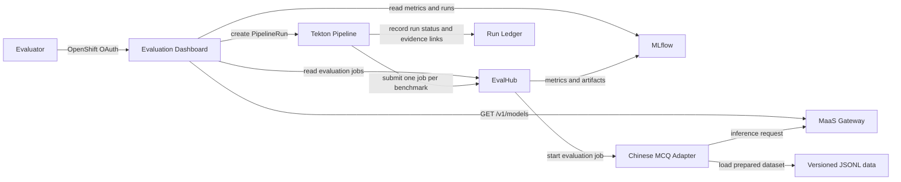

# EvalHub Lab

A model evaluation lab for Chinese multiple-choice benchmarks on **Red Hat OpenShift AI 3.5**. It combines an EvalHub adapter, a Tekton evaluation pipeline, MLflow tracking, and a web dashboard. Models are selected from the configured MaaS catalog or supplied through another supported inference endpoint.

## Architecture

The dashboard reads MLflow and EvalHub results, shows run provenance, and enables score comparisons only when the runs use compatible benchmarks and scoring protocols. Its **Architecture** page explains this flow; **Pipeline Runs** starts the configured MaaS evaluation pipeline.

## Benchmarks and scoring policy

The Chinese MCQ adapter supports these benchmark IDs:

- `hkmmlu`
- `tmmluplus`
- `cmmlu`
- `qualbench` — approved diagnostic subset only

QualBench is pinned to a source revision and evaluated with the approved diagnostic exclusions recorded in [PREFLIGHT.md](adapters/chinese-mcq/PREFLIGHT.md). Results must retain the **QualBench diagnostic subset** label and denominator. Full QualBench is not enabled.

The pipeline submits one EvalHub job for each selected benchmark, waits for the remote jobs to reach terminal states, collects MLflow run links, and records status in the durable ledger. Its gate checks execution and data quality. It does not make an accuracy acceptance decision unless approved thresholds are configured.

## Dashboard

The React and FastAPI dashboard provides:

- MLflow and EvalHub run history, filters, details, and exports
- Comparisons for compatible runs, with provenance and source conflicts shown
- An architecture walkthrough
- A PipelineRun form with MaaS model discovery, benchmark and profile selection, recent run status, and API-key input

The launcher queries the configured MaaS gateway's `GET /v1/models` endpoint and submits the exact model ID returned by that catalog. The API key is sent to the dashboard over HTTPS and is not retained in the browser or PipelineRun parameters. The server stages it in the configured Secret for the evaluation. It clears the key after all remote EvalHub jobs are terminal; if a job's state is unknown, it retains the key and blocks another dashboard run until reconciliation.

See the [dashboard README](evaluation-dashboard/README.md) and its [OpenShift deployment walkthrough](evaluation-dashboard/deploy/walkthrough.md).

## Repository map

| Path | Purpose |
| --- | --- |
| `adapters/chinese-mcq/` | EvalHub provider, prompts, parser, and dataset preparation |
| `config/qualbench-corrections-diagnostic-v2.json` | Approved QualBench diagnostic corrections and exclusions |
| `tekton/maas-evaluation/` | Pipeline, tasks, runner, install and launch helpers, and operating guide |
| `evaluation-dashboard/` | Dashboard source, API, deployment manifests, and walkthrough |
| `deploy/openshift/` | Isolated EvalHub and PostgreSQL manifests |
| `.cursor/skills/evalhub-disconnected-deployment/` | Disconnected build, transfer, and install instructions |

## Deploy and run

### Prerequisites

- OpenShift AI 3.5 with EvalHub, MLflow, and OpenShift Pipelines available
- A registered Chinese MCQ provider and prepared, versioned benchmark data
- A MaaS gateway and API key for inference, or another supported model endpoint
- A registry for the runner image and the required project-scoped permissions

### Install

1. Deploy the isolated EvalHub service and PostgreSQL database using [deploy/openshift/README.md](deploy/openshift/README.md), if they are not already available.
2. Prepare datasets, configure the runtime profile, build the runner image, and install the pipeline by following [tekton/maas-evaluation/README.md](tekton/maas-evaluation/README.md).
3. Deploy the authenticated dashboard by following [evaluation-dashboard/deploy/walkthrough.md](evaluation-dashboard/deploy/walkthrough.md).

Use the dashboard's **Pipeline Runs** page to load the MaaS model catalog, provide the inference key, choose a profile and benchmark set, and create a PipelineRun. For an inexpensive smoke run, select the `smoke` profile and `hkmmlu`. For direct CLI submission and reconciliation, use the commands in the pipeline guide.

Keep MaaS keys, OpenShift tokens, and generated secret material out of Git. An OpenShift login token grants cluster access; it is not an inference API key.

## Disconnected deployment

Use the [disconnected deployment skill](.cursor/skills/evalhub-disconnected-deployment/SKILL.md) and [deployment guide](.cursor/skills/evalhub-disconnected-deployment/README.md). They stage images and datasets on a connected host, transfer checksummed artifacts, and install from an internal registry and PVC without cluster-side public downloads.

## Operational boundaries

Repository manifests and source files document the deployment workflow; they do not by themselves prove that a provider is registered, the pipeline is installed, or a benchmark has completed. Check the dashboard's source status and MLflow run links for live results. For a PipelineRun, use the reconciliation steps in the [pipeline guide](tekton/maas-evaluation/README.md) if an EvalHub job remains active or its state is uncertain.
