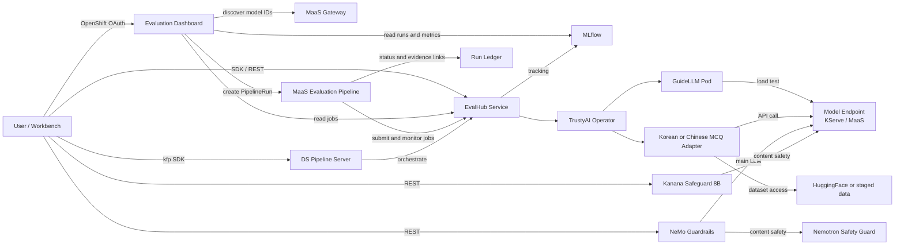

# RHOAI EvalHub Lab

A hands-on lab for evaluating language models and AI safety guardrails on **Red Hat OpenShift AI 3.5** with **EvalHub** and **MLflow**. It includes Korean benchmark notebooks, a Chinese MCQ adapter and MaaS evaluation pipeline, a web dashboard for run history and comparisons, and content-safety evaluations with NeMo Guardrails and Kanana Safeguard. Evaluations can target MaaS endpoints or models deployed in the cluster.

## Architecture




**How it works:**

- **EvalHub** is a lightweight REST API service that orchestrates LLM evaluations across multiple backends (lm-evaluation-harness, GuideLLM, RAGAS, LightEval, and more). It is GA in OpenShift AI 3.5, managed by the TrustyAI Operator.
- **GuideLLM (Phase 1):** Run inference performance benchmarks using [GuideLLM](https://github.com/neuralmagic/guidellm) through EvalHub to measure TTFT, ITL, throughput, and end-to-end latency.
- **Korean MCQ (Phase 2):** Run individual Korean MCQ benchmarks (KMMLU, CLIcK, HAE-RAE, etc.) through the EvalHub SDK with MLflow tracking. Summarize and export results as Markdown/HTML reports.
- **Unified Evaluation (Phase 3):** Run multi-benchmark evaluations and unified accuracy + performance (Korean MCQ + GuideLLM) experiments under a single MLflow experiment, with comparison tables and visualization.
- **KFP Pipeline (Phase 4):** The notebook workflow can submit a Kubeflow Pipeline (KFP v2) to OpenShift AI Data Science Pipelines for accuracy, performance, reporting, and Slack notification.
- **Chinese MCQ and MaaS pipeline:** The `chinese-mcq` adapter evaluates `hkmmlu`, `tmmluplus`, `cmmlu`, and the approved QualBench diagnostic subset. The separate Tekton workflow submits one EvalHub job per selected benchmark, waits for results, collects MLflow links, and applies an execution/data-quality gate.
- **Guardrails Evaluation (Phase 5):** Deploy and evaluate content safety guardrails — NeMo Guardrails (Nemotron Safety Guard) and Kanana Safeguard 8B — on Korean hate speech using the [K-MHaS](https://huggingface.co/datasets/nayohan/K-MHaS) dataset, with side-by-side model comparison.

## Model

This workshop supports two model deployment modes:


| Mode                          | Description                                        | Config                                        |
| ----------------------------- | -------------------------------------------------- | --------------------------------------------- |
| **MaaS (Model-as-a-Service)** | External API endpoint (e.g., cloud-hosted model)   | `MODEL_ENDPOINT` + `MODEL_API_KEY` in `.env`  |
| **KServe (Cluster-deployed)** | InferenceService on OpenShift AI with vLLM runtime | `MODEL_NAME` + `NAMESPACE` → auto-derived URL |


Evaluated models include **GLM-53-Flash** (MaaS), **Gemma 4 12B**, **Qwen3.6-27B-FP8**, **EXAONE 4.0 32B**, and **Qwen3-14B**.

### Current EvalHub lab deployment

The `deploy/openshift` manifests deploy EvalHub and a dedicated PostgreSQL database into the `evalhub-lab` namespace. On the cluster used for this deployment, the EvalHub Route is `https://evalhub-evalhub-lab.apps.cluster-v4vsc.v4vsc.sandbox287.opentlc.com`.

The default MaaS target for this lab is:

```text
MODEL_NAME=gpt-oss-20b
MODEL_ENDPOINT=https://maas.apps.cluster-v4vsc.v4vsc.sandbox287.opentlc.com/llm/gpt-oss-20b
```

Inference also requires a MaaS API key in `MODEL_API_KEY`. An OpenShift login token is for cluster access and cannot be used as the MaaS inference key. See [`deploy/openshift/README.md`](deploy/openshift/README.md) for the isolated service setup.

QualBench is enabled only as the approved diagnostic subset with the documented source anomalies excluded; full QualBench remains disabled. See [`adapters/chinese-mcq/PREFLIGHT.md`](adapters/chinese-mcq/PREFLIGHT.md) for the pinned data policy. The separate manual Tekton workflow is documented in [`tekton/maas-evaluation/README.md`](tekton/maas-evaluation/README.md); these versioned assets do not by themselves confirm a live provider registration or cluster deployment.

The dashboard provides run history, comparison, an architecture walkthrough, and a MaaS PipelineRun launcher. The launcher discovers model IDs with the provided MaaS key, lets the user choose benchmarks and a run profile, and creates the configured PipelineRun. See the [dashboard overview](evaluation-dashboard/README.md) and [OpenShift deployment walkthrough](evaluation-dashboard/deploy/walkthrough.md). Comparison scores are enabled only when runs have compatible benchmark and scoring provenance.

For disconnected deployments, use the [`evalhub-disconnected-deployment` skill](.cursor/skills/evalhub-disconnected-deployment/SKILL.md) and its [deployment guide](.cursor/skills/evalhub-disconnected-deployment/README.md). The bundle stages datasets and images on a connected host, transfers checksummed artifacts, and installs from an internal registry and PVC without cluster-side public downloads.

## What's Included

### 0. Setup

- **[0_setup/1_eval_hub_setup.ipynb](0_setup/1_eval_hub_setup.ipynb)**: Configure the EvalHub SDK against an already deployed service, check connectivity, configure MLflow tracking, and submit sample Korean benchmark jobs.
- **[deploy/openshift](deploy/openshift/README.md)**: Deploy the isolated EvalHub service and PostgreSQL database. MLflow is managed separately by the cluster's OpenShift AI installation.

### 1. GuideLLM Performance Benchmark (Phase 1)

- **1_eval_hub_guidellm_benchmark/1_guidellm_benchmark.ipynb**: Run inference performance benchmarks using GuideLLM through EvalHub SDK. Measures TTFT, ITL, throughput, and end-to-end latency with multiple execution profiles (quick baseline, rate sweep, constant load).

### 2. Korean MCQ Benchmark (Phase 2)

- **2_eval_hub_kmcq_benchmark/1_kmcq_benchmark.ipynb**: Run a single Korean MCQ benchmark (e.g. KMMLU, CLIcK, HAE-RAE) through EvalHub SDK with MLflow tracking. Includes job management and result export.
- **2_eval_hub_kmcq_benchmark/2_summarize_results.ipynb**: Load results from `results/<model>/`, build comparison tables, aggregate by category/supercategory, and export to Markdown and HTML reports.
- **2_eval_hub_kmcq_benchmark/generate_report.py**: Generate a standalone HTML report with interactive Chart.js visualizations and comparison tables.

### 3. Unified Evaluation (Phase 3)

- **3_eval_hub_unified_benchmark/1_unified_benchmark.ipynb**: Run multi-benchmark evaluations, sample size comparisons, and unified accuracy + performance (Korean MCQ + GuideLLM) experiments under a single MLflow experiment. Includes MLflow integration, comparison tables, and result export.

### 4. Evaluation Pipeline (Phase 4)

- **4_eval_pipeline/1_run_pipeline.ipynb**: Compile and submit the end-to-end evaluation pipeline to Data Science Pipelines (KFP v2). Runs 5 Korean benchmarks + GuideLLM throughput in a single pipeline run, generates HTML/Markdown reports, and sends Slack notifications.
- **4_eval_pipeline/pipeline.py**: Pipeline definition — accuracy, performance, report generation, and notification steps.
- **4_eval_pipeline/compile.py**: Compile the pipeline to `eval_pipeline.yaml` for submission.

### 5. Guardrails Evaluation (Phase 5)

- **5_eval_guardrail/1_guardrail_setup.ipynb**: (Admin) Deploy NeMo Guardrails with two configurations — `guardrail-regex-only` (regex patterns) and `guardrail-content-safety` (regex + Nemotron Safety Guard 8B). Demonstrates progressive content safety: regex alone fails on Korean hate speech, while the content safety model blocks it.
- **5_eval_guardrail/2_guardrail_test.ipynb**: (User) Interactive testing of guardrail configurations. Send Korean text through both configs side-by-side to compare regex-only vs content-safety filtering behavior.
- **5_eval_guardrail/3_evaluate_guardrail_nemo.ipynb**: (User) Evaluate the NeMo Guardrails + Nemotron Safety Guard content safety pipeline on the K-MHaS Korean hate speech dataset. Computes precision, recall, F1, confusion matrix, per-category breakdown, and generates a self-contained HTML report with LLM-generated recommendations.
- **5_eval_guardrail/3_evaluate_guardrail_kanana.ipynb**: (User) Evaluate Kanana Safeguard 8B on the same K-MHaS dataset. Same evaluation pipeline and metrics, enabling direct comparison with the NeMo Guardrails approach.

### 6. Evaluation Dashboard

- **[evaluation-dashboard](evaluation-dashboard/README.md)**: React and FastAPI app for MLflow and EvalHub run history, filters, comparable-run analysis, metric details, and exports.
- The **Architecture** page diagrams the dashboard, MaaS, Tekton, EvalHub, adapter, MLflow, and run-ledger flow. The **Pipeline Runs** page discovers MaaS model IDs, accepts a run-scoped API key, and launches the configured evaluation pipeline.
- **[evaluation-dashboard/deploy/walkthrough.md](evaluation-dashboard/deploy/walkthrough.md)**: Deploy the OAuth-protected dashboard with project-scoped source and PipelineRun access.

### 7. MaaS Evaluation Pipeline

- **[tekton/maas-evaluation](tekton/maas-evaluation/README.md)**: Install and run the Tekton pipeline for `hkmmlu`, `tmmluplus`, `cmmlu`, and the approved diagnostic `qualbench` subset.
- Each selected benchmark becomes an EvalHub job. The pipeline waits for terminal job states, collects MLflow links, records status in the durable ledger, and applies an execution/data-quality gate. It does not define an accuracy acceptance threshold unless one is configured.

## Korean Benchmark Datasets


| Dataset                                                                     | Description                                      | Categories                                      | Samples |
| --------------------------------------------------------------------------- | ------------------------------------------------ | ----------------------------------------------- | ------- |
| **[KMMLU](https://huggingface.co/datasets/HAERAE-HUB/KMMLU)**               | Korean Massive Multi-task Language Understanding | 45 subjects (STEM, HUMSS, Applied Science)      | 35,030  |
| **[CLIcK](https://huggingface.co/datasets/EunsuKim/CLIcK)**                 | Cultural and Linguistic Intelligence in Korean   | 11 categories (Culture + Language)              | 1,995   |
| **[KoBEST](https://huggingface.co/datasets/skt/kobest_v1)**                 | Korean Balanced Evaluation of Significant Tasks  | WiC, CoPA, BoolQ, HellaSwag, SentiNeg           | 6,100+  |
| **[HAE-RAE](https://huggingface.co/datasets/HAERAE-HUB/HAE_RAE_BENCH_1.1)** | Korean Language Proficiency Benchmark            | 6 categories (General Knowledge, History, etc.) | 1,538   |

The Chinese MCQ adapter also supports `hkmmlu`, `tmmluplus`, and `cmmlu`. `qualbench` is available only as a diagnostic subset with the approved anomalous source rows excluded. See the [adapter preflight policy](adapters/chinese-mcq/PREFLIGHT.md) and [pipeline guide](tekton/maas-evaluation/README.md) for dataset revisions, subset labeling, and preparation steps.


## Reports


| Report                                                                                                      | Description                                                                                                               |
| ----------------------------------------------------------------------------------------------------------- | ------------------------------------------------------------------------------------------------------------------------- |
| [Korean LLM Benchmark Report](https://hyogrin.github.io/rhoai-evalhub-lab/report.html)                                                        | Multi-model accuracy comparison across 5 Korean benchmarks with interactive Chart.js visualizations and per-category breakdowns |
| [NemoTron-Safety-Guard — Guardrail Report](https://hyogrin.github.io/rhoai-evalhub-lab/guardrail/guardrail_eval_guardrail-content-safety_2000_report.html) | NeMo Guardrails content safety evaluation on K-MHaS (2,000 samples) — confusion matrix, category breakdown, LLM recommendations |
| [Kanana-Safeguard-8B — Guardrail Report](https://hyogrin.github.io/rhoai-evalhub-lab/guardrail/guardrail_eval_guardrail-kanana-safety_2000_report.html) | Kanana Safeguard content safety evaluation on K-MHaS (2,000 samples) — confusion matrix, category breakdown, LLM recommendations |


## Evaluation Results

### Korean MCQ Benchmark Results

We evaluated **GLM-53-Flash**, **Gemma 4 12B**, **Qwen3.6-27B-FP8**, **EXAONE 4.0 32B**, and **Qwen3-14B** on 5 Korean benchmarks using the custom `korean-mcq` EvalHub adapter with up to 10,000 samples per dataset. Evaluations were orchestrated via EvalHub SDK, with results tracked in MLflow.

**MLflow Tracing** is enabled — each LLM call (prompt/response) is recorded as a structured trace span via `MlflowClient.start_trace()` API, visible in the MLflow UI's Traces tab.


| Benchmark           | GLM-53-Flash | Gemma4-12B | Qwen3.6-27B | EXAONE4-32B | Qwen3-14B | Samples |
| ------------------- | ------------ | ---------- | ----------- | ----------- | --------- | ------- |
| CLIcK               | **94.96%**   | 73.88%     | 75.90%      | 68.30%      | 66.82%    | 1,995   |
| HAE-RAE Bench 1.1   | **77.01%**   | 69.87%     | 60.43%      | 63.20%      | 54.64%    | 1,538   |
| KMMLU (0-shot)      | **86.48%**   | 57.51%     | 62.50%      | 52.24%      | 48.30%    | 10,000  |
| KMMLU-HARD (0-shot) | **79.21%**   | 33.80%     | 43.06%      | 29.48%      | 27.95%    | 10,000  |
| KoBEST BoolQ        | **97.77%**   | 96.08%     | 96.65%      | 91.52%      | 93.23%    | 1,404   |


### Performance (GuideLLM Throughput)


| Metric            | GLM-53-Flash | EXAONE4-32B | Gemma4-12B | Qwen3-14B | Qwen3.6-27B |
| ----------------- | ------------ | ----------- | ---------- | --------- | ----------- |
| Output tokens/sec | 32.54        | 47.74       | 22.86      | 26.65     | 11.40       |
| Prompt tokens/sec | 74.84        | 107.43      | 51.19      | 52.05     | 25.41       |
| Requests/sec      | 1.00         | 0.74        | 0.36       | 0.19      | 0.18        |


> 📄 **Full report:** [Korean LLM Benchmark Report](https://hyogrin.github.io/rhoai-evalhub-lab/report.html) — interactive Chart.js visualizations with per-category accuracy comparisons across all models.

### Guardrail Content Safety Evaluation Results

Two content-safety guardrail models were evaluated on Korean hate speech detection using the [K-MHaS](https://huggingface.co/datasets/nayohan/K-MHaS) (Korean Multi-label Hate Speech) dataset from COLING 2022. Both evaluations used **2,000 samples** from the validation split with binary classification (Hate Speech vs Not Hate Speech).

**Setup:**

- **NeMo Guardrails + [Llama 3.1 Nemotron Safety Guard 8B](https://huggingface.co/nvidia/llama-3.1-nemoguard-8b-content-safety)** — deployed via KServe (vLLM runtime, 1× GPU), `guardrail-content-safety` config with regex + S1–S13 unsafe content categories
- **[Kanana Safeguard 8B](https://huggingface.co/kakaocorp/kanana-safeguard-8b)** — deployed via KServe (vLLM runtime, 1× GPU), standalone content safety model
- **Dataset:** K-MHaS — 109,692 utterances total, 8 hate categories (Age, Gender, Race, Religion, Disability, Profanity, Sexual, Not Hate Speech)

**Model Comparison (2,000 samples):**

| Metric | NemoTron Safety Guard | Kanana Safeguard 8B | Winner |
| ------------------- | --------------------- | ------------------- | -------------- |
| Precision | 0.721 | 0.714 | NemoTron (↑) |
| Recall | 0.776 | **0.905** | Kanana (↑) |
| F1-Score | 0.748 | **0.798** | Kanana (↑) |
| Accuracy | 0.772 | **0.800** | Kanana (↑) |
| False Positive Rate | 0.231 | 0.280 | NemoTron (↓) |
| False Negative Rate | 0.224 | **0.095** | Kanana (↓) |
| FP+FN (Classification Errors) | 456 | **399** | Kanana (↓) |

**Confusion Matrix — NemoTron Safety Guard:**

|                             | Predicted: Allowed | Predicted: Blocked |
| --------------------------- | ------------------ | ------------------ |
| **Actual: Not Hate Speech** | TN = 869           | FP = 261           |
| **Actual: Hate Speech**     | FN = 195           | TP = 675           |

**Confusion Matrix — Kanana Safeguard 8B:**

|                             | Predicted: Allowed | Predicted: Blocked |
| --------------------------- | ------------------ | ------------------ |
| **Actual: Not Hate Speech** | TN = 814           | FP = 316           |
| **Actual: Hate Speech**     | FN = 83            | TP = 787           |

**Key Findings:**

- **Kanana Safeguard 8B** achieves significantly higher recall (0.905 vs 0.776), meaning it catches far more hate speech — only 9.5% missed vs. 22.4% missed by NemoTron. It leads in F1, Accuracy, and total classification errors.
- **NemoTron Safety Guard** has a lower false positive rate (23.1% vs 28.0%), making it less likely to block legitimate messages incorrectly. Better suited when minimizing over-blocking is the priority.
- Regex-only configuration (`guardrail-regex-only`) **cannot detect Korean hate speech at all** — it only matches English patterns and structured data (SSN, credit cards, etc.). A content safety model is essential for multilingual coverage.

> 📄 **Full reports:** [NemoTron-Safety-Guard — Guardrail Report](https://hyogrin.github.io/rhoai-evalhub-lab/guardrail/guardrail_eval_guardrail-content-safety_2000_report.html) · [Kanana-Safeguard-8B — Guardrail Report](https://hyogrin.github.io/rhoai-evalhub-lab/guardrail/guardrail_eval_guardrail-kanana-safety_2000_report.html) — includes per-category breakdown and LLM-generated recommendations.

## Prerequisites

- Red Hat OpenShift AI 3.5+ cluster with TrustyAI Operator installed
- EvalHub and MLflow available in the target workspace. The setup notebook configures the SDK against an existing EvalHub service; see [`deploy/openshift/README.md`](deploy/openshift/README.md) for the isolated EvalHub deployment.
- A model endpoint — either:
  - **MaaS:** External API endpoint URL + API key
  - **KServe:** Model deployed via KServe (vLLM runtime)
- `oc` CLI access to the cluster
- Hugging Face API token

## Quick Start

### Option A: Cluster owner and dashboard operator

1. Clone this repository into your OpenShift AI Workbench or development environment:
   ```bash
   git clone https://github.com/jaysonzhao/evalhub-lab.git
   cd evalhub-lab
   ```
2. If EvalHub is not already available, follow [`deploy/openshift/README.md`](deploy/openshift/README.md) to deploy the lab service and database. Configure a MaaS API key separately for inference; it is not an OpenShift login token.
3. Register the Chinese MCQ provider and prepare its datasets using [`tekton/maas-evaluation/README.md`](tekton/maas-evaluation/README.md). Install the pipeline with its approved runtime profile and image.
4. Deploy the dashboard by following [`evaluation-dashboard/deploy/walkthrough.md`](evaluation-dashboard/deploy/walkthrough.md). The dashboard depends on the pipeline resources and its configured MaaS gateway.
5. Open the dashboard route, review **Architecture**, then use **Pipeline Runs** to load MaaS models, enter the inference key, choose a profile and benchmarks, and submit a run. Use **Overview** and **Compare runs** to inspect completed results.

### Option B: Run the notebook workflow

1. Clone the repository and open [`0_setup/1_eval_hub_setup.ipynb`](0_setup/1_eval_hub_setup.ipynb).
2. Copy `sample.env` to `.env` and set the EvalHub URL, model endpoint, MaaS API key, and other values for your environment.
3. Run the setup notebook against an already deployed EvalHub service, then run the benchmark notebooks in order:
   - `1_eval_hub_guidellm_benchmark/1_guidellm_benchmark.ipynb` — Inference performance profiling (TTFT, ITL, throughput)
   - `2_eval_hub_kmcq_benchmark/1_kmcq_benchmark.ipynb` — Single Korean MCQ benchmark evaluation
   - `2_eval_hub_kmcq_benchmark/2_summarize_results.ipynb` — Analyze results and generate Markdown/HTML reports
   - `3_eval_hub_unified_benchmark/1_unified_benchmark.ipynb` — Multi-benchmark + unified accuracy/performance evaluation
   - `4_eval_pipeline/1_run_pipeline.ipynb` — Historical KFP v2 workflow (requires Data Science Pipelines)
   - `5_eval_guardrail/1_guardrail_setup.ipynb` — Deploy NeMo Guardrails with content safety model
   - `5_eval_guardrail/2_guardrail_test.ipynb` — Test guardrail configurations interactively
   - `5_eval_guardrail/3_evaluate_guardrail_nemo.ipynb` — Evaluate NeMo Guardrails on K-MHaS Korean hate speech dataset
   - `5_eval_guardrail/3_evaluate_guardrail_kanana.ipynb` — Evaluate Kanana Safeguard on K-MHaS Korean hate speech dataset

### Workshop participant (shared cluster)

No cluster setup is required when the owner has already deployed EvalHub and MLflow and provides workspace access.

1. Clone the repository and copy `sample.env` to `.env`.
2. Set the EvalHub URL, workspace, model endpoint, and MaaS API key provided for your environment.
3. Open [`0_setup/1_eval_hub_setup.ipynb`](0_setup/1_eval_hub_setup.ipynb) to verify access, then run the notebooks you need.

> **Local development:** If you have [uv](https://docs.astral.sh/uv/) installed, you can use `uv sync` instead for a reproducible virtual environment.

## Phase Comparison


|                         | Phase 1: GuideLLM              | Phase 2: Korean MCQ         | Phase 3: Unified                   | Phase 4: Pipeline               | Phase 5: Guardrails            |
| ----------------------- | ------------------------------ | --------------------------- | ---------------------------------- | ------------------------------- | ------------------------------ |
| **Approach**            | GuideLLM via EvalHub SDK       | Single Korean MCQ benchmark | Multi-benchmark + GuideLLM unified | KFP v2 pipeline on DS Pipelines | NeMo Guardrails + Safety Model |
| **What it measures**    | TTFT, ITL, throughput, latency | Accuracy per benchmark      | Accuracy + performance combined    | End-to-end automated evaluation | Content safety filter accuracy |
| **Scope**               | Performance only               | One benchmark at a time     | All benchmarks + performance       | All phases automated            | Korean hate speech detection   |
| **Experiment Tracking** | Built-in MLflow                | Built-in MLflow             | Unified MLflow experiment          | Pipeline run + MLflow           | CSV + HTML report              |
| **Best For**            | Capacity planning              | Quick single-task eval      | Production comprehensive eval      | CI/CD and scheduled evaluations | Safety compliance validation   |


## About

This workshop was built through real debugging and iteration on OpenShift AI. Key learnings documented:

- EvalHub (GA in RHOAI 3.5) orchestrates evaluations via REST API with built-in MLflow tracking
- The `korean-mcq` custom adapter evaluates Korean benchmarks with per-question accuracy
- Both MaaS endpoints (external API) and KServe InferenceServices (cluster-internal) are supported
- OAuth-protected InferenceServices require RBAC + SA token via `OPENAI_API_KEY` env var
- SSL verification must be disabled for self-signed certs (`verify_certificate: "False"`)
- NeMo Guardrails supports multi-config deployment — `config_id` must be nested inside the `guardrails` object in the request body
- Reasoning models (e.g., GLM-53-Flash) consume `max_tokens` for internal thinking before generating content — set a sufficiently large `max_tokens` when using them for text generation

## References

- **[evaluate-llm-on-korean-dataset](https://github.com/hyogrin/evaluate-llm-on-korean-dataset)** — Accumulated Korean LLM benchmark results across major open-weight models (Gemma, Llama, Phi, Qwen, etc.) with per-category breakdowns and radar chart visualizations.
- **[evaluate-contentfilter-on-korean-dataset](https://github.com/hyogrin/evaluate-contentfilter-on-korean-dataset)** — Reference implementation for evaluating content safety filters on the K-MHaS Korean hate speech dataset.

